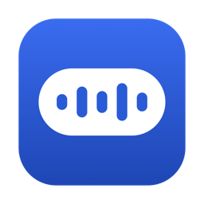
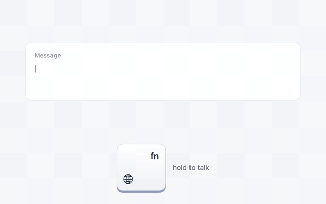
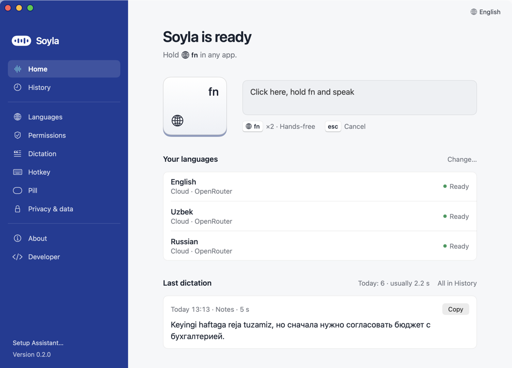
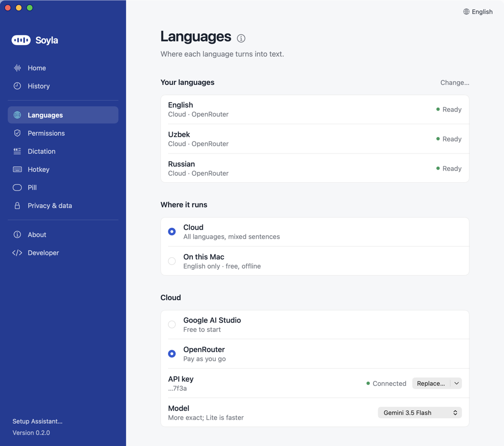
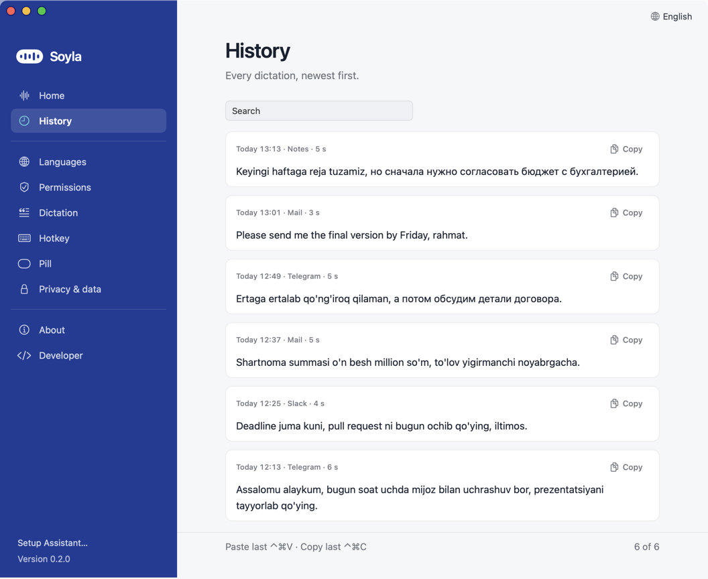
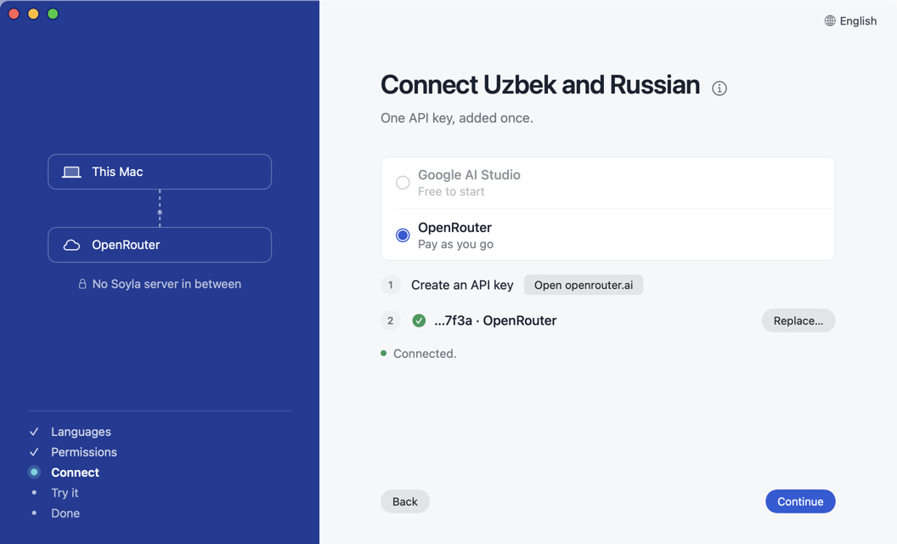
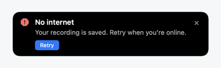

<p align="center"></p>

<h1 align="center">Soyla</h1>

<p align="center"><b>Push-to-talk dictation for macOS that keeps Uzbek, Russian and English in one sentence.</b></p>

<p align="center">
  
  
  
  <a href="LICENSE"></a>
</p>

<p align="center">
  <a href="https://github.com/ShamsiddinKomil/soyla/releases/latest">Download</a> ·
  <a href="docs/INSTALL.md">Install guide</a> ·
  <a href="#documentation">Documentation</a> ·
  <a href="docs/FAQ.md">FAQ</a> ·
  <a href="docs/SECURITY_MODEL.md">Security model</a>
</p>

<p align="center"></p>

Hold a key, speak the way you actually talk ("Kecha mijoz bilan gaplashdim, но есть один нюанс…"), let go. The text lands where your cursor is: Uzbek in Latin, Russian in Cyrillic, with no language switch to flip.

## Early access

You're here because you were invited: Soyla is in a private preview before it goes public. Thank you for trying it.

- **Please keep it to yourself for now.** Don't forward the repository or the download. If someone wants in, point them to the author and they'll be added.
- **Use it for real for a week.** Your normal messages and notes, mixed sentences included, in the apps you actually use. Try a long dictation (a minute or more) and, if you have them, AirPods as well as the built-in microphone.
- **What helps most:**
  - **Wrong words or wrong script:** what you said and what was pasted, only if you're comfortable sharing the text.
  - **Setup:** any step where you hesitated or weren't sure what to do.
  - **Paste:** an app where the text didn't arrive.
  - **Speed:** whether the wait after you let go feels short enough.
- **How to send it:** [open an issue](https://github.com/ShamsiddinKomil/soyla/issues/new/choose) (Bug or Idea). In the app, **Report a Problem…** in the menu bar icon fills in your setup for you, without your dictated text, audio or keys. A two-line note is plenty; screenshots help.
- **Issues are visible to the other testers**, so leave out anything private. For something you'd rather not post, follow [SECURITY.md](SECURITY.md) or contact the author directly.
- **Expect rough edges:** each new version needs the one-time Open Anyway step (see Quick start), and things will change between versions.

## Features

- **Mixed languages in one sentence.** Built for people who switch between Uzbek, Russian and English mid-thought.
- **Works in any app.** Text goes where your cursor is: Telegram, Mail, Notes, a browser, a terminal.
- **Free English on your Mac.** New installs on macOS 26 (or earlier versions that have Apple's English speech model) start on Apple's on-device engine: no key, and your audio never leaves the Mac.
- **Your key, no account.** For Uzbek, Russian and mixed speech: OpenRouter or Google AI Studio (or any OpenAI-compatible server), connected right under the language it serves and stored in the macOS Keychain.
- **Hold, or lock hands-free.** Hold fn to talk; double-tap to keep recording; Esc cancels. Other hotkeys for non-Apple keyboards.
- **Never loses what you said.** The recording is on disk before anything is sent; no internet or a failed request leaves a Retry button.
- **Text as spoken.** No rewriting by default. An optional correction pass removes repeats and applies "no, I mean…" corrections; replacements and a spelling list fix names and terms.
- **History.** Every dictation with its text, app and time; copy, play or retry it. ⌘⌃V pastes the last one again.
- **In your language.** The app speaks English, Uzbek or Russian (the globe menu, top right).
- **Private by design.** No Soyla server, no telemetry, no screenshots. Mic off between dictations. [What leaves your Mac](docs/PRIVACY_AND_COST.md).

## Screenshots

<table>
  <tr>
    <td width="50%"></td>
    <td width="50%"></td>
  </tr>
  <tr>
    <td align="center"><b>Home</b>: your languages and the last dictation</td>
    <td align="center"><b>Languages</b>: Cloud or On this Mac, per language</td>
  </tr>
  <tr>
    <td></td>
    <td></td>
  </tr>
  <tr>
    <td align="center"><b>History</b>: copy, play or retry any dictation</td>
    <td align="center"><b>Setup Assistant</b>: about two minutes, start to finish</td>
  </tr>
</table>

<p align="center">
  
  &nbsp;
  
</p>

## Quick start

Needs **macOS 14 or newer** on Apple silicon (Intel is untested). English can run free on the Mac; Uzbek, Russian and mixed speech need an API key from OpenRouter or Google AI Studio.

1. **Download** `Soyla-vX.Y.Z.zip` from [Releases](https://github.com/ShamsiddinKomil/soyla/releases/latest) (the only official source), unzip it and drag `Soyla.app` to Applications.
2. **Open it once with Open Anyway.** macOS says it cannot verify the app: click **Done**, then System Settings → Privacy & Security → **Open Anyway**. Once per version ([why](docs/INSTALL.md)).
3. **Follow the Setup Assistant** (about two minutes): pick your languages, allow the microphone and Accessibility, connect a key if you chose Uzbek or Russian, and try one sentence.
4. **For Uzbek or Russian, connect a key.** [OpenRouter](https://openrouter.ai/keys) is recommended for mixed speech (add $5 of credit; about half a cent per 40 seconds). [Google AI Studio](https://aistudio.google.com/apikey) has a free tier but is reliable for one language at a time, and free-tier audio may be used by Google. Step by step: [docs/KEYS.md](docs/KEYS.md).
5. **Dictate.** Click into any text field, **hold fn**, speak, release.

## Documentation

| Guide | What's in it |
|---|---|
| [Install](docs/INSTALL.md) | Download, the one-time Open Anyway step, the Setup Assistant with pictures |
| [Connect Uzbek and Russian](docs/KEYS.md) | Getting an OpenRouter or Google AI Studio key and connecting it |
| [Using Soyla](docs/USAGE.md) | Gestures, the pill, Home, Languages, Dictation settings, History, shortcuts |
| [Permissions](docs/PERMISSIONS.md) | What each macOS permission is for, and fixing them after an update |
| [Troubleshooting](docs/TROUBLESHOOTING.md) | Fixes by symptom: nothing happens, text doesn't appear, key rejected, no internet |
| [FAQ](docs/FAQ.md) | Offline use, cost, supported Macs, uninstalling |
| [Privacy and cost](docs/PRIVACY_AND_COST.md) | Exactly what leaves your Mac, what stays, and what it costs |
| [Security model](docs/SECURITY_MODEL.md) | Permissions, Keychain, updates and signing, with links to the code |
| [How it works](docs/HOW_IT_WORKS.md) | The dictation pipeline and a map of the code |
| [Contributing](CONTRIBUTING.md) | Building, testing and sending a change |

## Why Soyla

- **Code-switching is the point, not an edge case.** Most dictation apps decode each recording in one language. Soyla sends your audio to a general-purpose model with a prompt built for mixed Uzbek/Russian/English speech. On a 41-second clip that switches languages mid-sentence, the default setup kept both scripts in 7 of 7 runs.
- **Your key, your data.** Audio goes from your Mac straight to the provider you choose, with your own key. Nothing is sent to the author.
- **Measured in the open.** Every dictation is logged locally with a full latency timeline, and the replay tool re-sends the same recording to other models, so comparisons use identical audio ([docs/HARNESS.md](docs/HARNESS.md)).

## How it compares

| | Soyla | Wispr Flow | Superwhisper | VoiceInk | Handy | Apple Dictation |
|---|---|---|---|---|---|---|
| Price | Free; you pay your provider (about $0.005 per 40 s) | Free tier; Pro from $12/mo | Free tier; Pro from $8.49/mo | Paid licence; free to build | Free | Free |
| Open source | ✓ MIT | ✗ | ✗ | ✓ GPL-3.0 | ✓ MIT | ✗ |
| Where your speech goes | The provider you pick, with your own key; English can stay on the Mac | Wispr's cloud | On-device or cloud, per model | On-device; cloud optional | On-device | On-device or Apple |
| Built for mixed-language sentences | ✓ the reason it exists | ✗ one language per dictation | Not advertised | Not advertised | Not advertised | ✗ switch languages by hand |
| Works offline | English only (free on-device engine) | ✗ | ✓ local models | ✓ local models | ✓ | Partly |
| Platforms | macOS 14+ | Mac, Windows, iOS, Android | macOS, Windows | macOS 15+ | macOS, Windows, Linux | Apple devices |

**Pick something else if** you need offline or fully on-device dictation (Handy, VoiceInk), Windows or a phone (Wispr Flow, Handy), or you dictate in one language and want heavy rewriting of your text (Wispr Flow). Soyla is for people who mix Uzbek, Russian and English and want the words kept as spoken.

<sub>Checked 2026-10-16 against each product's own site and docs. Prices change; corrections welcome via an issue.</sub>

## Privacy and security

- **What leaves your Mac:** the recording (and, with the correction pass on, the text) goes to the provider you chose. Soyla also asks GitHub once a day whether a new version exists. Nothing goes to the author: no telemetry, no analytics, no crash reports. Full list: [docs/PRIVACY_AND_COST.md](docs/PRIVACY_AND_COST.md).
- **Permissions, explained:** the microphone records only while you hold the key; the hotkey listener compares each key with your hotkey and drops it, never storing or logging what you type; Accessibility is used to paste, not to read your screen. [docs/SECURITY_MODEL.md](docs/SECURITY_MODEL.md) has the details with links to the code.
- **Keys** stay in one macOS Keychain item that never syncs to other devices.
- **Updates** install only on your click, and only if the new app is signed with the same certificate as yours. Each release names the commit it was built from and lists a SHA-256 checksum.
- **Found a problem?** Report it privately: [SECURITY.md](SECURITY.md).

## How it works

```
 hold fn ──► mic (16 kHz WAV, streamed to disk) ──► release
                                                      │
          ┌───────────────────────────────────────────┘
          ▼
   one request: audio + a prompt for mixed uz/ru/en  ──►  provider (your key)
          │                                                     │
          ◄──────────────── transcript ─────────────────────────┘
          ▼
   optional correction pass (text only) → personal dictionary → ⌘V into the focused app
          │
          └──► History row + recording on your Mac (14 days by default)
```

The recording is written to disk while you speak and a History row exists before any network call, so a crash, a dead Wi-Fi or a rejected key never loses what you said: Retry re-sends the file. Code map: [docs/HOW_IT_WORKS.md](docs/HOW_IT_WORKS.md).

## Measured so far

Default model (Gemini 3.5 Flash via OpenRouter), MacBook Pro M4 Pro, home Wi-Fi in Tashkent, October 2026:

| Measurement | Result |
|---|---|
| Release to pasted text, median | 2.3 s |
| Release to pasted text, 90th percentile | 3.3 s |
| Cost per dictation of 12 to 26 s | $0.002 to $0.003 |
| Mixed uz↔ru 41 s clip, both scripts kept | 7 / 7 runs (OpenRouter) · about 1 in 2 (Google AI Studio direct) |

A word-error-rate table on the long test scripts in [docs/TEST_SCRIPTS.md](docs/TEST_SCRIPTS.md) is the next thing to publish; the scoring tool (`scripts/score.py`) is in the repo.

## Known limits

- **Not signed by Apple**, so the first open of each version takes the Open Anyway detour. After an update, macOS can show Accessibility and Input Monitoring as on while trusting nothing; switch them off and on ([why](docs/PERMISSIONS.md#after-an-update-toggles-look-on-but-nothing-works)). macOS also asks for your password once before Soyla may read its saved key again.
- **fn is an Apple-keyboard key.** On other keyboards pick Right ⌥, Right ⌘, Right ⌃, ⌃⇧Space or F13 in Settings.
- **AirPods and other Bluetooth headsets** record in phone-call quality, and an iPhone nearby can grab them. New installs therefore record from the built-in microphone even when a headset is connected (Settings → Privacy & data to change it).
- **Uzbek, Russian and mixed speech are online only.** The free on-device engine is English only; cloud dictations made offline are kept and retried later.
- **Gemini free tier trains on your audio.** Use OpenRouter or a paid key for anything confidential.
- **Live text** (words while you speak) is a preview only and needs a Google AI Studio key.

## Roadmap

Next: the published accuracy table, a Homebrew cask, deleting History rows in the app, and a one-call transcribe-and-clean mode if it proves faster. Ideas and bugs: [open an issue](https://github.com/ShamsiddinKomil/soyla/issues). This is a small project used daily by its author, so expect small, frequent releases rather than big ones.

## Build it yourself

Apple's free Command Line Tools are enough (no Xcode, no third-party packages):

```
git clone https://github.com/ShamsiddinKomil/soyla.git && cd soyla
scripts/test.sh                   # the test suite
NO_INSTALL=1 scripts/bundle.sh    # → build/Soyla.app (without NO_INSTALL it also installs to /Applications)
```

The CLI (`soyla replay`, `report`, `paste-test`, …), the measurement protocol and the code map: [CONTRIBUTING.md](CONTRIBUTING.md), [docs/HOW_IT_WORKS.md](docs/HOW_IT_WORKS.md), [docs/HARNESS.md](docs/HARNESS.md). Developer mode in Settings reveals the latency panel and run tagging.

## Contributing and license

Pull requests are welcome; see [CONTRIBUTING.md](CONTRIBUTING.md) and the [Code of Conduct](CODE_OF_CONDUCT.md). Changes per version: [CHANGELOG.md](CHANGELOG.md).

**Thanks** to [OpenRouter](https://openrouter.ai) and [Google AI Studio](https://aistudio.google.com) for the models, and to the open-source dictation apps whose public discussions shaped Soyla's design, especially [VoiceInk](https://github.com/Beingpax/VoiceInk) and [Handy](https://github.com/cjpais/Handy). No code from them is used.

MIT, © Shamsiddin Komil. Soyla ("speak" in Uzbek) is built in Tashkent.
