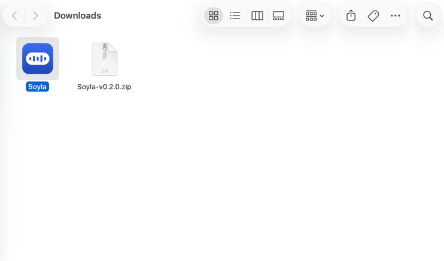
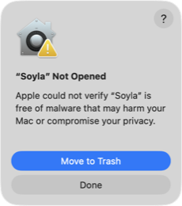
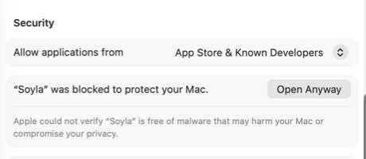
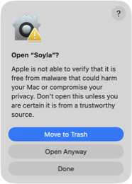
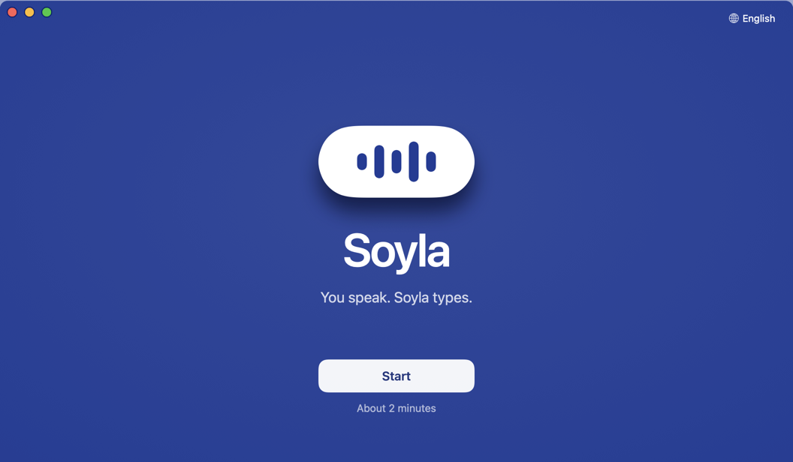
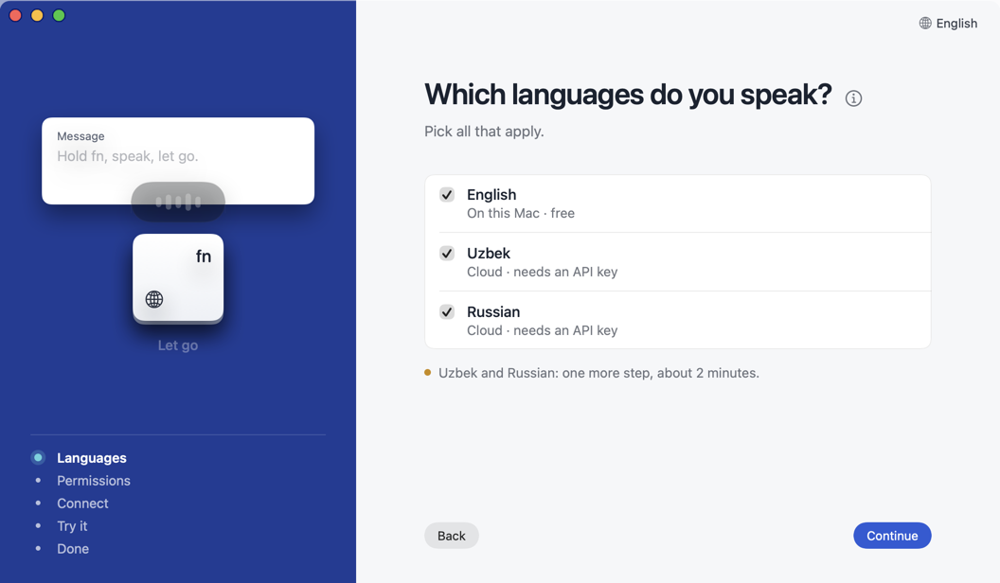
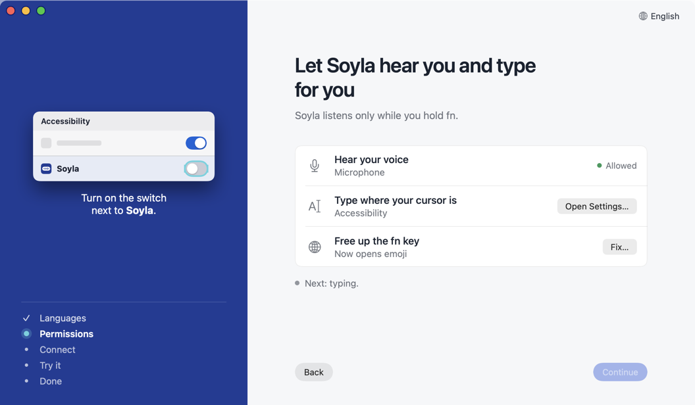
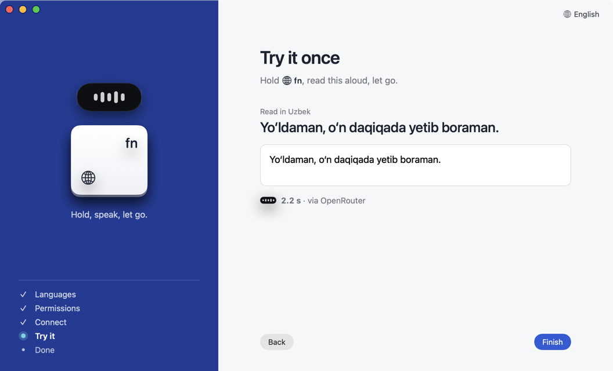
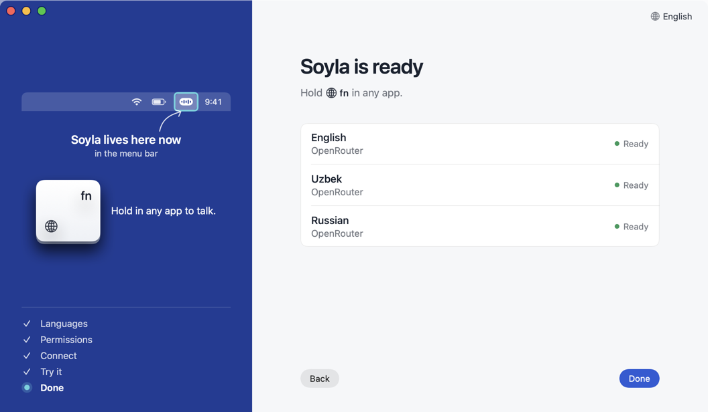
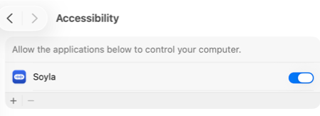

# Install Soyla

Soyla is a free Mac app with a window, a Dock icon and a menu-bar icon. It is not signed by Apple yet, so the first open needs one extra click. This page takes you from download to your first dictation, with a picture at each step.

**What you need:** a Mac with macOS 14 or newer. English works right away with no account. For Uzbek and Russian you add your own key later ([Keys](KEYS.md)).

## 1. Download and install

1. Open the [latest release](https://github.com/ShamsiddinKomil/soyla/releases/latest) in your browser.
2. Under **Assets**, click `Soyla-vX.Y.Z.zip` (the numbers are the version).
3. Open your **Downloads** folder and double-click the zip. The app, `Soyla`, appears next to it.

   

4. Drag `Soyla.app` onto **Applications** in the Finder sidebar (under Favorites).

**Download Soyla only from this repository's [Releases](https://github.com/ShamsiddinKomil/soyla/releases) page.** There is no other official download, website installer or App Store version. A copy from anywhere else may not be ours.

**Optional: check that the download is intact.** Each release lists a `Soyla-vX.Y.Z.zip.sha256` file next to the zip. Download it into the same folder, then run this in Terminal:

```
cd ~/Downloads && shasum -a 256 -c Soyla-vX.Y.Z.zip.sha256
```

`Soyla-vX.Y.Z.zip: OK` means the zip is exactly the file that was published. Each release's notes also print the signing certificate's SHA-256 fingerprint; it is the same for every release, so a different one means the app is not ours ([details](SECURITY_MODEL.md)).

To see the fingerprint of the app you downloaded (after unzipping it in Downloads):

```
cd ~/Downloads && codesign -d --extract-certificates=/tmp/soyla-cert Soyla.app && shasum -a 256 /tmp/soyla-cert0
```

The long number it prints must match the one in the release notes.

**Never post your API key** in an issue or anywhere else. Soyla and its author will never ask for it.

## 2. First open: "Open Anyway" (one time per version)

Why this step exists: Apple checks and approves apps through a paid developer account, and Soyla does not have one yet. Soyla is open source, so you can read the code or [build it yourself](#5-build-it-yourself-instead).

1. Open **Applications** and double-click **Soyla**.
2. macOS shows a warning: *"Apple could not verify "Soyla" is free of malware that may harm your Mac or compromise your privacy."* Click **Done**. (Do not click Move to Trash.)

   

3. Open **System Settings** (Apple menu, top-left) and click **Privacy & Security** in the sidebar.
4. Scroll down to the **Security** section. You will see **"Soyla" was blocked to protect your Mac.** Click **Open Anyway**. The button stays for about an hour after the failed open. If it is gone, repeat step 2.

   

5. Type your Mac login password (or use Touch ID) and click **OK**.
6. macOS asks once more. Click **Open Anyway**.

   

7. Soyla starts. A window opens with the Setup Assistant, and the Soyla icon (a small sound-wave mark) appears in the menu bar (left of the other icons in this picture). From now on double-clicking works normally.

   

**Notes**

- You repeat this once for every new version you download.
- On **macOS 14 (Sonoma)** you can instead right-click (or Control-click) the app and choose **Open**, then **Open** again. On macOS 15 and later that shortcut no longer works, so use the steps above.

### Then: the Setup Assistant (about 2 minutes)

Soyla opens the Setup Assistant on first launch. It has six steps: Welcome, Languages, Permissions, Connect, Try it, Done. You can run it again any time from **Setup Assistant…** at the bottom of the sidebar.

1. **Welcome.** Click **Start**.

   

2. **Languages.** Tick the languages you speak. English runs on your Mac, free, with no key. Uzbek and Russian run in the cloud and need an API key.

   

3. **Permissions.** Click each button and follow the short hint on the left of the window: **Allow…** for the microphone (then click **Allow** in the macOS pop-up), **Open Settings…** for Accessibility (switch **Soyla** on), and **Fix…** to set the fn key to **Do Nothing**. Each row turns to "Allowed" or "Done" when it is right. Details: [Permissions](PERMISSIONS.md).

   

4. **Connect.** Only if you picked Uzbek or Russian. Choose a service, create an API key there, paste it and click **Connect**. Step by step: [Keys](KEYS.md). No key yet? Click **Skip for now**; English still works.

   

5. **Try it.** Hold fn (or your hotkey), read the sentence on screen aloud, and let go. Your words appear in the box.

   

   On a Mac that has to fetch Apple's English speech model, this step may say "Getting English ready on this Mac…" for a moment. It is a one-time download from Apple. On macOS 14 and 15 it may also ask you to allow **Speech Recognition** for English; click **Allow…**.

   If Soyla says it can't hear the fn key yet, an extra **Input Monitoring** row appears. Click **Open Settings…** and switch **Soyla** on.

6. **Done.** Soyla now lives in the menu bar. Hold fn in any app to talk.

   

Next: [Using Soyla](USAGE.md).

## 3. Alternative for Terminal users

One command removes the "downloaded from the internet" mark, so macOS never shows the warning:

```
xattr -dr com.apple.quarantine /Applications/Soyla.app
```

Then open Soyla normally.

## 4. After an update: permissions look ON but nothing works

After you replace Soyla with a newer version, macOS can keep showing Soyla as ON in Accessibility and Input Monitoring while no longer trusting the new build. Symptoms: the hotkey does nothing, or text is not pasted.

Fix: switch Soyla **off and on again** in System Settings, Privacy & Security, under **Accessibility** and under **Input Monitoring**.



Terminal users can instead reset the grants and allow them again. Both ways are explained in [Permissions](PERMISSIONS.md#after-an-update-toggles-look-on-but-nothing-works).

## 5. Build it yourself instead

You need only Apple's free Command Line Tools (`xcode-select --install`), not Xcode. Three commands:

```
git clone https://github.com/ShamsiddinKomil/soyla.git && cd soyla
scripts/bundle.sh      # builds Soyla and installs it in /Applications
open -a Soyla
```

A build made on your own Mac is not downloaded from the internet, so macOS shows no warning. Details for developers: [CONTRIBUTING](../CONTRIBUTING.md).

## 6. Uninstall

1. Click the Soyla icon in the menu bar and choose **Quit Soyla**.
2. Drag `Soyla.app` from Applications to the Trash.
3. Optional, to remove your data:
   - Delete the folder `~/Library/Application Support/Soyla` (in Finder: Go menu, Go to Folder, paste the path). Your API keys are in it (`keys.json`), so they go too.
   - Only if you never opened a version that moved keys out of the Keychain: open **Keychain Access**, search for `ai.soyla.app`, and delete the items found.
   - In System Settings, Privacy & Security, remove Soyla from Accessibility and Input Monitoring (select it, click the minus button).

## Homebrew (from v0.3.0)

From the v0.3.0 release on, Soyla can also be installed from its own tap (the cask is [`Casks/soyla.rb`](../Casks/soyla.rb)):

```
brew install --cask ShamsiddinKomil/soyla/soyla
```

Homebrew downloads the same zip from this repository's Releases and checks its SHA-256. The first open still needs **Open Anyway** once (section 2), or the command in section 3. Until the v0.3.0 release is out, use sections 1 and 2.
