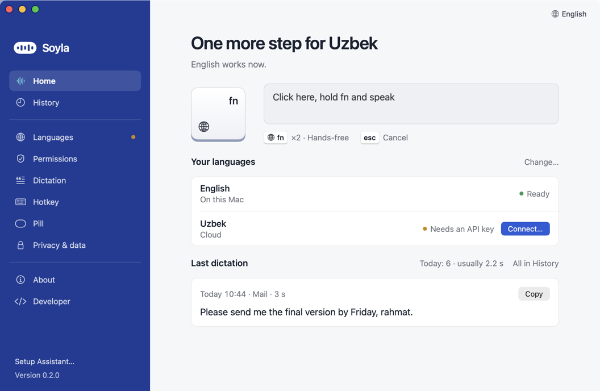
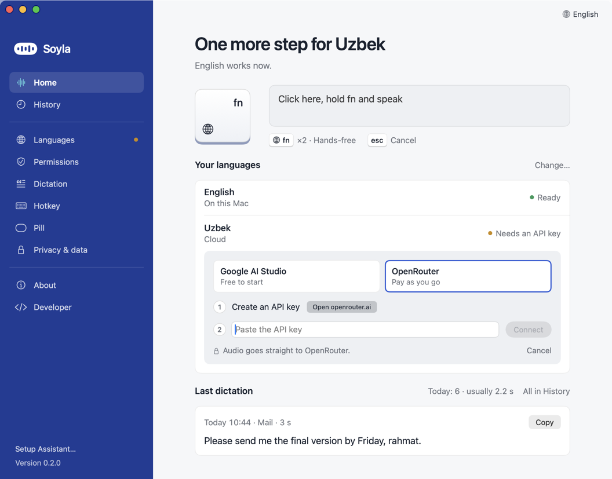

# Connect Uzbek and Russian

English works in Soyla with no key. For **Uzbek, Russian and mixed speech** Soyla sends your recording to an AI service, and for that it needs **your own API key**: a long password that tells the service the usage is yours. Soyla has no account and no server of its own. Setting up a key takes about two minutes, once.

**One key covers both Uzbek and Russian.** You only need one service.

## Which service?

| | OpenRouter | Google AI Studio |
|---|---|---|
| Cost | Pay as you go, about half a cent per 40 seconds of speech | Free tier available, or paid |
| Mixed Uzbek and Russian in one sentence | **Reliable** | Unreliable (see below) |
| One language at a time | Works | Works |
| Google can train on your audio | See OpenRouter's privacy settings | **Yes, on a free-tier key** |

**Pick OpenRouter** unless you cannot pay. It is the one that keeps both languages when you switch mid-sentence. In our test on a 41-second clip that switches between Uzbek and Russian, OpenRouter kept both languages 7 times out of 7. Google AI Studio used directly kept both only about half the time. For one language at a time, Google AI Studio is fine and has a free tier.

See [Privacy and cost](PRIVACY_AND_COST.md) for what the free tier means for your audio and a real cost table.

## Step 1. Create a key at the service

*Steps checked on 2026-10-16. Websites change, so button names may differ slightly.*

### OpenRouter (recommended)

You need an email or a Google/GitHub account, and a bank card (Visa/Mastercard), AliPay or USDC for at least $5 of credit.

1. **Sign up.** Open [openrouter.ai](https://openrouter.ai) and click **Sign in**.
2. **Add credit.** Open [openrouter.ai/settings/credits](https://openrouter.ai/settings/credits) and buy credit. The minimum is **$5**, which lasts a long time. Card payments carry a fee of about 5.5% (at least $0.80); crypto about 5%. Credit you don't use can expire after a year.
3. **Create a key.** Open [openrouter.ai/keys](https://openrouter.ai/keys) and click **Create Key**.
4. **Name it and cap it.** Call it `Soyla` and set a **credit limit**, for example $5. If the key ever leaks, nobody can spend more than that.
5. **Copy the key.** It starts with `sk-or-`. Copy it right away; it may not be shown again. If you lose it, delete it and create a new one.

**Paying from Uzbekistan:** OpenRouter doesn't publish which countries' cards it accepts. If your card is refused, try another card or use Google AI Studio.

### Google AI Studio

You need a Google account (18 or older). Uzbekistan is on Google's list of supported countries. The free tier needs no card.

1. **Open** [aistudio.google.com/apikey](https://aistudio.google.com/apikey) and sign in.
2. **Accept the terms** the first time. AI Studio then creates a project and a key for you.
3. If you don't see a key, click **Create API key**.
4. **Copy the key.** Older keys start with `AIza`; keys made since May 2026 may start with `AQ.`. If Soyla refuses a new-style key, please [open an issue](https://github.com/ShamsiddinKomil/soyla/issues).

**Free tier and your audio:** on the free tier, Google uses what you send to improve its products, and people at Google may read it. That is fine for trying Soyla. For anything private, turn on billing: on the API keys page click **Set up billing** in the *Billing Tier* column (prepaid, from $5).

**Limits:** free-tier limits change over time. AI Studio shows yours at [aistudio.google.com/rate-limit](https://aistudio.google.com/rate-limit).

## Step 2. Paste it into Soyla

Your key is stored on your Mac in a private file that only your user account can open (`~/Library/Application Support/Soyla/keys.json`). Soyla never logs it and never sends it anywhere except to the service it belongs to. [More on how it is kept](SECURITY_MODEL.md#keys).

1. Open Soyla. On **Home**, click **Connect…** next to Uzbek or Russian. (Or go to **Languages** in the sidebar. In the Setup Assistant, the **Connect** step shows the same thing.)

   

2. A panel opens with two service tiles: **Google AI Studio** (*Free to start*) and **OpenRouter** (*Pay as you go*). Click the one you created a key for.
3. Click **Open openrouter.ai** (or **Open aistudio.google.com**) if you still need to create the key, then copy it.
4. Click the field **Paste the API key**, paste, and click **Connect**. Soyla saves the key and checks it with the service. You see **Checking…**, then the panel closes.

   

5. Open **Languages** to confirm. The **API key** row says **Connected**, and each language says **Ready**.

   

In the Setup Assistant the same panel looks like this:

Then hold your hotkey (fn by default) and speak. [Using Soyla](USAGE.md) has the details.

## If the key does not work

The panel tells you what happened:

- **That key is for the other service. Pick it above.** You pasted an OpenRouter key while Google AI Studio was selected, or the other way round. Click the right tile and paste again. Nothing was saved.
- **That doesn't look like an API key. Copy it again.** The text was cut off or is not a key. Copy the whole key from the service.
- **That key didn't work. Check it and try again.** The service refused it. Make sure it is complete and not deleted, and that your OpenRouter account has credit.
- **Couldn't reach the service. Check the internet and try again.** You may be offline.

Later, the **API key** row on Languages shows one of these words: **Checking…**, **Connected**, **Key rejected** (the service refused it) or **Not checked** (Soyla could not reach the service).

More help: [Troubleshooting](TROUBLESHOOTING.md#your-api-key-was-refused).

## Replace or remove a key

1. Open **Languages** and find the **API key** row under **Cloud**.
2. Click **Replace…** and paste the new key, as in step 2 above.
3. To delete the key, click the small arrow on **Replace…** and choose **Remove key**, then confirm. Uzbek and Russian stop working until you add a key again.

To use the other service, click its tile under **Cloud** on the Languages page. If it has no key yet, click **Connect…** on its **API key** row.

## Custom endpoint (advanced)

If you run your own server, or use another service that speaks the OpenAI chat API, Soyla can use it. Open **Developer** in the sidebar and turn on **Developer mode**. A **Custom** service then appears under **Cloud** on the Languages page (that section shows once you have connected a key), with a **Base URL** and a **Model** field. Soyla posts to `{base}/chat/completions`. The address must be `https`. Plain `http` is allowed only for a server on this Mac (`localhost`, `127.0.0.1`, `::1`). A server elsewhere on your network needs `https`: on shared Wi-Fi another device can pretend to be it.

## Safety

Never paste a key into a chat, an email or a screenshot. If you did, delete that key at the service and create a new one.
