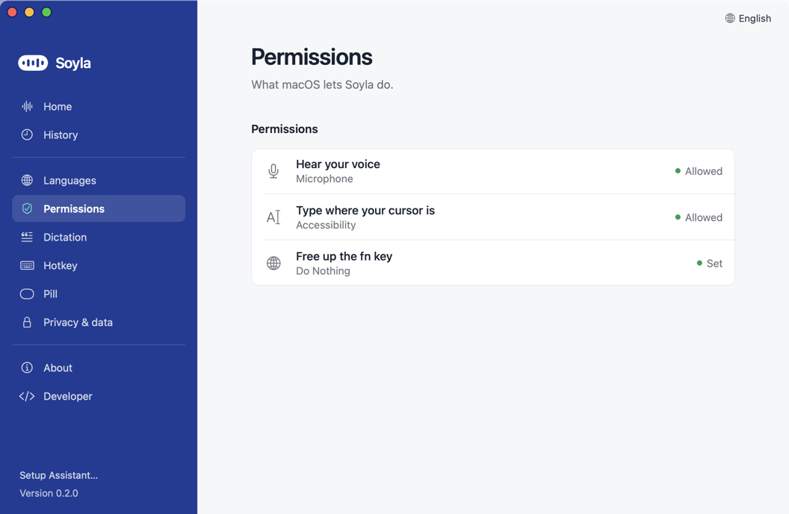

# Permissions

macOS asks you to approve a few things before Soyla can work. Each one has one job, and Soyla does nothing else with it. Soyla does not take screenshots and does not read what is on your screen. See [Privacy and cost](PRIVACY_AND_COST.md).

## What Soyla asks for

Soyla's **Permissions** page lists up to five rows. **Hear your voice** and **Type where your cursor is** are always there. The fn row shows only while your hotkey is fn. The last two appear only when needed.

| Row in Soyla | macOS name | What it is for |
|---|---|---|
| **Hear your voice** | Microphone | Recording your voice while you hold the hotkey |
| **Type where your cursor is** | Accessibility | Pasting the text where your cursor is |
| **Free up the fn key** | Keyboard setting, "Press 🌐 key to" | Stops macOS from using fn for emoji or Apple Dictation. This is a setting, not a permission |
| **Notice the fn key** | Input Monitoring | Shown only if Soyla still cannot see your hotkey after Accessibility is on |
| **Recognize English on this Mac** | Speech Recognition | Shown only on macOS 14 and 15, and only when English runs "On this Mac" (the free engine) |

## Grant them

The Setup Assistant walks you through this on first launch (step **Permissions**). You can also do it any time:

1. Open Soyla and click **Permissions** in the sidebar.
2. Each row shows **Allowed** (or **Set**) in green when it is done. Otherwise it has a button: **Allow…** (microphone and Accessibility), **Fix…** (fn key) or **Open Settings…** (Input Monitoring). In the Setup Assistant, the Accessibility button says **Open Settings…**.
3. Follow the macOS prompt, or switch **Soyla** on in the list that opens. If Soyla is not in the list, click **+** and choose Soyla in Applications.
4. Come back to Soyla. The row turns green by itself; no restart is needed.



In the Setup Assistant the same rows appear, with a short hint on the left that says what to click in macOS:


## The fn key setting: "Press 🌐 key to" Do Nothing

The default hotkey is **fn** (the 🌐 globe key on many Macs). By default macOS also uses that key to open the emoji picker, switch the input source or start Apple Dictation, which fights with Soyla. To turn that off:

1. Click **Fix…** on the **Free up the fn key** row. System Settings opens.
2. Next to **Press 🌐 key to**, choose **Do Nothing**.

The row then says **Set**.

If your keyboard has no fn key (many non-Apple keyboards), pick another hotkey in **Hotkey** in the sidebar, under **Hold to talk**: Right ⌥, Right ⌘, Right ⌃, ⌃⇧Space or F13.

## If Soyla can't hear the fn key

On the **Try it** step, if no key press arrives, Soyla says "Soyla can't hear the fn key yet." and shows a **Notice the fn key** row (Input Monitoring). Click **Open Settings…** and switch **Soyla** on. The same row appears on the Permissions page.

If it still does nothing, see [After an update](#after-an-update-toggles-look-on-but-nothing-works) below, or pick a different hotkey as above.

## Other apps that use fn

Only one app should listen to fn at a time. Other dictation apps such as **Wispr Flow** and **Amical** also use it. If one is running, both apps may start dictating at once. Quit the other app, or give Soyla a different hotkey.

## After an update: toggles look ON but nothing works

macOS can treat a new version of Soyla as a different app even though the switches in the lists still look on. Symptoms: the hotkey does nothing, or text is not pasted.

Fix, either way:

1. **By hand:** in System Settings, Privacy & Security, switch Soyla **off and on again** under **Accessibility**, then under **Input Monitoring**.

   

2. **Or in Terminal:** this makes macOS forget Soyla's old grants so it asks again.

   ```
   tccutil reset Accessibility ai.soyla.app; tccutil reset ListenEvent ai.soyla.app
   ```

   Then open Soyla and allow both again on the Permissions page.

The same advice with the download steps is in [Install](INSTALL.md#4-after-an-update-permissions-look-on-but-nothing-works).

Next: [Using Soyla](USAGE.md), or [Troubleshooting](TROUBLESHOOTING.md) if something is still stuck.
