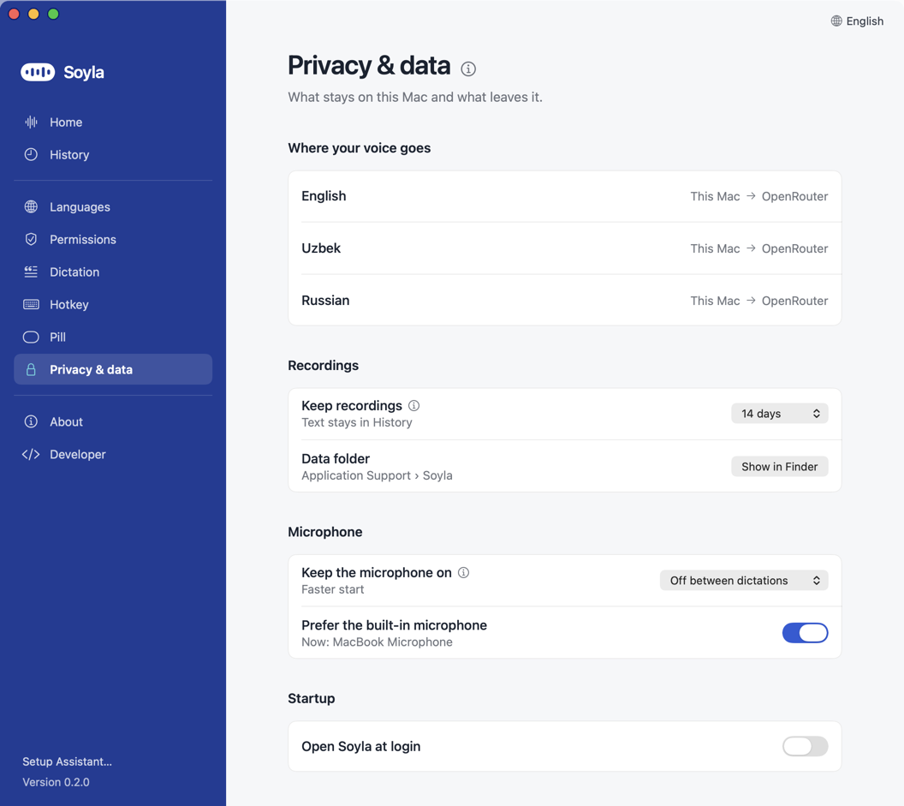

# Privacy and cost

Soyla has no server and no account. With the free **On this Mac** engine, your voice never leaves your Mac. With **Cloud**, it goes from your Mac straight to the AI provider **you** chose, using **your** key. This page lists exactly what leaves your Mac, what stays on it, and what it costs.

## The free engine: nothing leaves your Mac

**On this Mac** (English only) uses Apple's speech recognition on your Mac. **No audio and no text is sent anywhere**, and it needs no key. The one network use is that Apple may download its English speech model once, the first time you use it. After that it works offline. On macOS 14 and 15 it also asks for the **Speech Recognition** permission.

In this mode there is no correction pass, and no live text, because those need a cloud service. Uzbek, Russian and mixed speech need **Cloud**.

**Where your voice goes** (Settings, Privacy & data) shows this for each of your languages: "Stays on this Mac" for the free engine, or "This Mac → OpenRouter" (or the service you use) for Cloud.

## What leaves your Mac with Cloud

When you finish a dictation, Soyla sends one request to your provider (OpenRouter, Google AI Studio, or your custom server):

- **Your recording** (the audio of that dictation).
- **A short instruction** telling the model to transcribe, plus your languages (My languages and Mainly speak) and the names from the **Spelling** box (Settings, Dictation), if you filled it in.
- **With the Correction pass on:** a second request that sends the recognised **text** (not audio) to be tidied, with your names and terms and the **name of the app** the text is going into (for example "Mail"), so the model can match its tone.

If you use OpenRouter, OpenRouter passes the request on to the company that runs the model (for the default model that is Google). Their privacy terms apply as well; read them if the content is sensitive.

A few other things can leave your Mac:

- **Live text** (off by default; Settings, Pill): while you record, audio is streamed to Google's servers for the preview. It needs a Google AI Studio key. **Instant results with Live** is on by default only when Google AI Studio is your engine (with OpenRouter or a custom server it stays off unless you turn it on). While you hold the key, the audio goes to Google Live (up to three sessions, one per language, when the language is Auto) so the text can paste about 1.5 s sooner; a press you cancel with Esc has still been heard by Google up to that point. These sessions count against your Google key's quota. To turn it off: Settings, Developer: switch on Developer mode, then **Instant results with Live**.
- **A backup request (Cloud only):** if your provider has not answered after about 3 seconds (a little longer for long recordings), Soyla sends the same recording a second time and uses whichever answer comes first. Same provider, same data.
- **Testing a key:** pasting a key sends it to that provider's server once to check it.
- **Keeping the connection warm:** right before a dictation, and every 25 seconds for 10 minutes after you last used it, Soyla makes a tiny signed-in request to your provider so the next dictation does not wait for a new connection. It carries your key, never audio or text. Turn it off in Settings, Developer: switch on Developer mode, then **Pre-warm connection on key down**.

**Never sent to the Soyla author:** nothing. There is no Soyla server and **no telemetry or analytics**.

**Never captured:** Soyla does **not take screenshots and does not read your screen**, now or ever. To paste, it only asks macOS which app is in front and whether the focused spot looks like a text field.

**Update check:** at launch and then once a day, Soyla asks GitHub (`api.github.com`) for the number of the latest release, and nothing else. Turn it off in Settings, About, **Check daily**. **Check now** (or the Soyla menu, **Check for Updates…**) does it on demand. Only when you click **Update** (or turn on automatic install, off by default) does Soyla download the new version from this repository's Releases on `github.com`; it installs it only if it is signed with the same certificate as the app you have. Details: [Security model](SECURITY_MODEL.md).

**Report a Problem…** (menu bar icon or Help menu): builds a short text on your Mac (Soyla and macOS version, keyboard layout, hotkey, microphone name, provider and model, permission states, whether Secure Input is on, and the last run's status and timings). You see and can edit all of it. Nothing is sent by Soyla: **Open GitHub issue** only opens your browser on a prefilled issue page, and you press Submit. It never includes dictated text, audio or API keys, and your home folder is shown as `~`.

### Free-tier warning

**Google AI Studio keys on the free tier let Google train on your audio.** Use a paid key (or OpenRouter) for anything confidential: client calls, health, money, passwords spoken aloud. See [Keys](KEYS.md).

## The microphone

By default the microphone is on **only while you hold the hotkey**, so the orange microphone dot in the menu bar appears only then. In Settings, Privacy & data, **Keep the microphone on** you can choose **For 30 s after a dictation** or **Always** for a faster start (the default is **Off between dictations**). In those modes the Mac's microphone indicator stays on, and Soyla keeps the **last 0.3 seconds** of sound in memory (RAM) so a word you started early is not cut. That buffer is thrown away continuously. It is never saved and never sent unless you press the hotkey. The microphone always closes when the screen locks or the Mac sleeps.

## Recordings on your Mac

Recordings and history live in `~/Library/Application Support/Soyla/` (open it from Settings, Privacy & data, **Show in Finder**). The folder is private to your user account.

Settings, Privacy & data, **Keep recordings**. The text always stays in History:

| Choice | What happens |
|---|---|
| **14 days** (default) | Recordings older than 14 days are deleted automatically (checked at launch and daily). |
| **Forever** | Never deleted by Soyla. |
| **Don't keep** | The recording exists only while the request runs, then is deleted. |

If an older version of Soyla saved a different choice (**7 days** or **Until it's pasted**), that choice is still shown and works until you pick another.

Exception: **a failed dictation always keeps its recording** so you can press **Retry**, even with Don't keep. Remove it by retrying, or delete it from the `recordings` folder. A cancelled recording that contained speech is also kept (unless Don't keep).

A recording takes about 2 MB per minute of speech.

## Transcripts: History

Every dictation's text (the original and the corrected version), time, model, length and cost is saved in History, in the file `runs.jsonl` in the same folder. This stays even when audio is deleted. History does not hold your keys.

**How to delete it:** there is no delete button in the app yet. Quit Soyla (menu bar icon, **Quit Soyla**), then delete `~/Library/Application Support/Soyla/runs.jsonl` in Finder (Go menu, **Go to Folder…**, paste the folder path). To remove everything Soyla stored, delete the whole `Soyla` folder. The stored keys are separate: see [uninstalling](INSTALL.md#6-uninstall).

## Your keys

Keys are stored in a private file on this Mac, `~/Library/Application Support/Soyla/keys.json`, that only your user account can open (no other user on the Mac can). It is left out of Time Machine backups, never syncs, and keys never appear in the log. Unlike the macOS Keychain, which Soyla used before, the file does not ask before other programs running as you read it; that is the price of no password dialog after every update ([details](SECURITY_MODEL.md#keys)). To delete one, open Settings, Languages, click **Replace…** next to the key (or its menu arrow), choose **Remove key** and confirm. Your languages stay; Cloud dictation stops until you add a key again.

## Clipboard

To paste, Soyla briefly puts the text on the clipboard, presses ⌘V for you, and then puts back what was on your clipboard before (if you did not copy something new in between). When pasting is blocked, the text is left on the clipboard on purpose and the pill says so.

## What it costs

Soyla is free and open source. You pay only your provider, per use. Real numbers from Soyla's own log (default model **Gemini 3.5 Flash** through OpenRouter), counts and costs only:

| Measurement | Result |
|---|---|
| Transcription, 6 recent live dictations, 12 to 26 s | $0.0019 to $0.0031 each |
| Transcription cost per second of speech | about $0.00012 |
| Correction pass (Light), per dictation | about $0.0015 to $0.003 (measured on 8 test clips) |

What that means for you (estimates from those rates):

| What you do | Approximate cost |
|---|---|
| One 10-second dictation | $0.001 (transcription) to $0.004 (with correction) |
| One 40-second dictation | $0.005 (transcription), about $0.007 to $0.008 with correction |
| 50 dictations of about 12 seconds in a day | about $0.15 to $0.20 |
| A month of that (20 working days), correction pass Raw (default) | about $1.50 |
| Same month with the correction pass on Light | about $3 to $4 |

Very short dictations (four words or fewer, no numbers) skip the correction pass and cost only the transcription. These are estimates from a small sample, not a quote: model prices change, so check the live price on the OpenRouter model page. Set a **credit limit** on your key ([Keys](KEYS.md)) so a surprise cannot get large.

The free **On this Mac** engine costs nothing at all: no key, no per-use fee.

Google AI Studio's free tier costs nothing in money, but see the training warning above and its rate limits.

Settings, Pill, **Transcript and timing** (After each dictation) shows the time and cost of each run on the pill.
