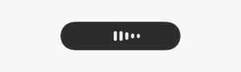
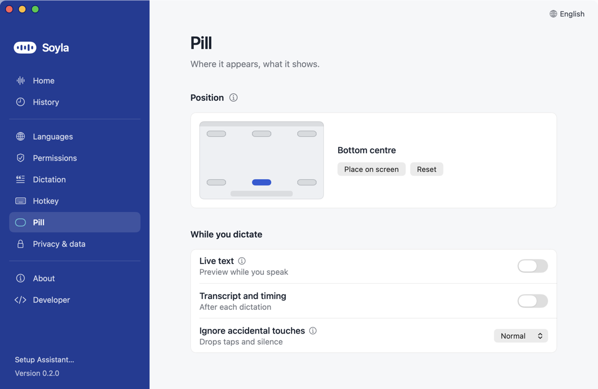
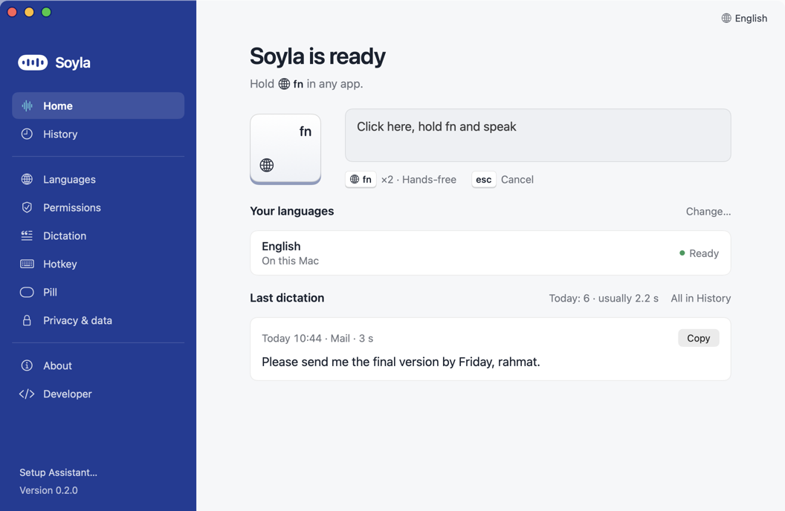
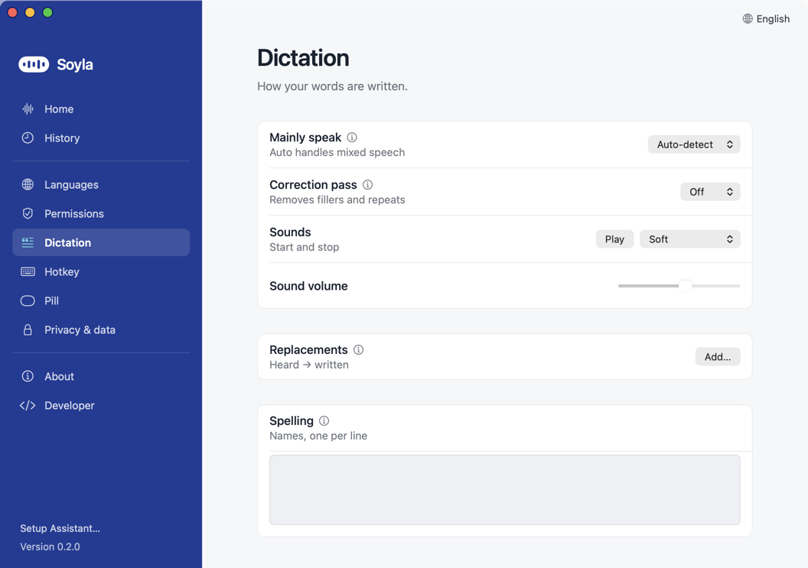
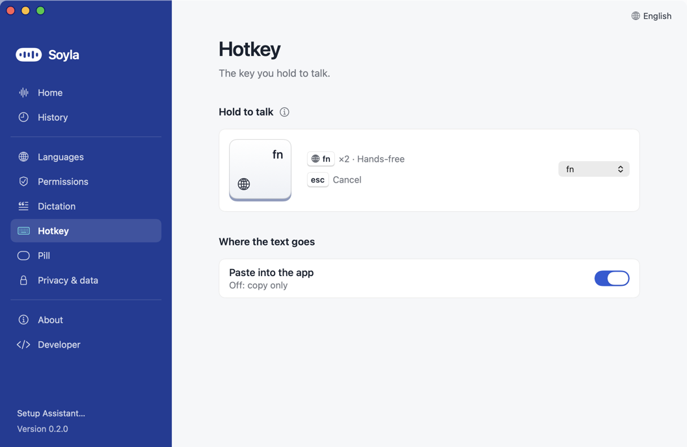

# Using Soyla

Hold a key, speak, let go. Soyla types what you said into whatever app has your cursor. You can mix Uzbek, Russian and English in one sentence.

This page assumes setup is done ([Install](INSTALL.md), [Keys](KEYS.md), [Permissions](PERMISSIONS.md)). The examples use the default hotkey, **fn**. You can change it in Settings, then Hotkey.

## A quick tour of Home

Home is the page you see when you click **Open Soyla**. From top to bottom:

- **Title and hint.** "Soyla is ready" and *Hold fn in any app.* If something is missing, the title says what (for example "Soyla can't hear you yet") and a button fixes it.
- **The fn key and the practice box.** Click the box, hold fn and speak to try it. Under it are the two shortcuts you need: **fn ×2** for hands-free and **esc** to cancel.
- **Your languages.** One row per language, each showing where it runs (for example *Cloud · OpenRouter*) and whether it is **Ready** or **Needs an API key**. **Change…** opens the Languages page.
- **Last dictation.** The latest text with a **Copy** button, today's count and **All in History**.

The sidebar has the rest: **History**, then the Settings pages (Languages, Permissions, Dictation, Hotkey, Pill, Privacy & data, About).

## Dictate: hold or lock

**Hold (push-to-talk).** Click into a text field anywhere. Press and hold **fn** for at least half a second, speak, then let go. A small pill appears at the bottom of the screen while you talk. When you let go, Soyla transcribes and pastes.

**Tap does nothing.** A press shorter than half a second is treated as an accident: no sound, nothing sent, nothing pasted. If your hotkey is a modifier key (fn, Right ⌥, Right ⌘ or Right ⌃), pressing any other key while you hold it cancels the recording, so shortcuts like fn+← do not start a dictation.

**Lock (hands-free).** Tap the key twice quickly: the second press must come within 0.6 seconds of letting go of the first. Soyla keeps listening without you holding anything, and the pill shows a lock instead of the red dot. To finish, press the key once more or click the pill. A press in the first second after locking is ignored, so a nervous third tap does not stop it.

**Tap, then hold.** If your second press is held for half a second or more, it is a normal hold after all: letting go sends it.

**Busy.** A press while Soyla is still finishing the last note shows *Still working on your last dictation*. If you keep holding the key until Soyla is free, it starts recording right then.

**Cancel.** Press **Esc** while the pill is showing (recording or transcribing). Nothing is pasted.

**Changing the microphone mid-recording.** If you plug in or switch a headset while recording, Soyla keeps recording and keeps what it already heard.

### Gesture cheat-sheet

| Gesture | What happens | Timing |
|---|---|---|
| Hold, speak, release | Records, then transcribes and pastes | Hold at least 0.5 s |
| Quick tap | Nothing: no sound, no paste | Shorter than 0.5 s |
| Tap twice | Hands-free recording (lock) | Second press within 0.6 s of releasing the first |
| Press while locked | Stops and sends | Ignored for 1 s after locking |
| Tap, then hold | A normal hold; release sends | Second press held 0.5 s or more |
| Other key while holding (fn, Right ⌥/⌘/⌃) | Cancels, nothing sent | Any time during the hold |
| Press while transcribing | "Still working" notice; starts recording if still held when free | |
| Esc | Cancels recording or transcribing | While the pill is showing |

The pill itself only appears after the key has been down for 0.1 seconds, so quick taps never flicker.

### Long dictations

You can talk for up to 5 minutes. Soyla sends your speech in pieces at natural pauses while you talk, so only the last few seconds are left when you let go. At 4:45 the pill turns amber and counts down, and you hear a soft double note from your sound set (nothing if Sounds is Off). At 5:00 Soyla stops and sends what it has. If you turn off *Transcribe while speaking* (Settings, Developer, switch on **Developer mode**, then Lab), the limit goes back to 55 seconds, because the whole recording then travels in one request.

### Silence is dropped

If you hold but say nothing (or almost nothing), Soyla sends nothing. A quick touch just disappears. If you locked or held for more than 1.5 seconds, the pill briefly says *Didn't catch that* (or *No speech heard* when it was silent), so you know to say it again. You can change how strict this is in Settings, Pill, **Ignore accidental touches**: **Relaxed**, **Normal** (default) or **Strict**.

## The pill

The pill is the small dark capsule that shows what Soyla is doing.

**Recording.** A red dot and the five bars of the Soyla mark. The bars stay low when you are silent and rise when you speak.

**Waiting.** After the recording, the bars move gently while Soyla transcribes. If it takes more than about 2 seconds it says *Still working…*. After about 4 seconds it says *Taking longer than usual…* and shows a **Cancel** button.

**If something fails,** the pill becomes a card with a plain-language title and a hint. Buttons you may see: **Retry** (sends the saved recording again), a button that opens the right Settings page, and an **x** to dismiss. Your recording is kept so nothing you said is lost. See [Troubleshooting](TROUBLESHOOTING.md) for each message.

**Move it.** Settings, Pill shows a small picture of your screen. Click one of the six spots (top or bottom; left, centre or right). For an exact spot, click **Place on screen** and drag the pill where you want it. You can also drag it while you are recording. It appears on the screen where your pointer is.

**Right-click the pill** for **Hide for 1 hour** (errors still show) and **Reset position**. Settings, Pill also has a **Reset** button next to **Place on screen** and, while the pill is hidden, **Show again**.

By default the pill shows only the animation. Two optional extras live in Settings, Pill, under **While you dictate**:

- **Live text** shows words while you speak. It is a preview only: the text that gets pasted still comes from the normal model after you finish. It needs a Google AI Studio key, and it may lag or stop on mixed-language speech. While it is on, your audio is also streamed to Google while you record (see [Privacy and cost](PRIVACY_AND_COST.md)).
- **Transcript and timing** shows the text, the total time and the cost on the pill after each dictation.

## Languages: Cloud or On this Mac

Settings, **Languages** says where each language turns into text. There are two places:

- **On this Mac** is Apple's speech engine. It is free, works offline, needs no key, and your audio never leaves the Mac. It does **English only**. Macs on macOS 26 use it by default; on macOS 14 and 15 it is used when Apple's English model is installed, and Soyla may download that model once.
- **Cloud** handles all your languages, including Uzbek, Russian and sentences that mix them. It needs your own API key from OpenRouter or Google AI Studio ([Keys](KEYS.md)). Your audio goes from your Mac straight to that service. There is no Soyla server.

With only English on this Mac, Home looks like this: one language, no key needed. To add Uzbek or Russian, click **Change…** or **Connect…** and paste a key. Soyla opens the Connect panel right there.

On the Languages page you can also:

- Pick the **Cloud** service (Google AI Studio or OpenRouter), and **Replace…** or remove its **API key**.
- Pick the **Model** (Cloud only). The Flash model is more exact; Lite is faster.

### My languages and Mainly speak

Settings, Dictation, **My languages**: tick the languages you speak (all three by default). Soyla tells the model
you speak only these, and checks the text: if it comes back in an alphabet none of them uses (for example Cyrillic
when Russian is unticked), Soyla asks once more. Keep all three for mixed speech. When not all three are ticked, a
small label on the pill (such as **RU** or **UZ·EN**) shows the set while you record.

Settings, Dictation, **Mainly speak**:

- **Auto-detect** (default) handles mixed sentences.
- **Uzbek**, **Russian** or **English** (only the ticked ones) is a hint. Pick one only if Soyla keeps guessing wrong; other languages you speak are still kept.

For mixed Uzbek and Russian, OpenRouter is the more reliable service ([Keys](KEYS.md)).

On the free engine the Dictation page hides **Mainly speak** and **Correction pass**, because that engine has one language and no correction. Sounds and the Personal dictionary stay.

## Paste Last and Copy Last

Pasted into the wrong place, or want the last text again? Press **⌘⌃V** (Command, Control, V) in any app to paste your last dictation again, or **⌘⌃C** to copy it. The same items are in the menu bar menu as **Paste Last Dictation** and **Copy Last Dictation**.

## The menu bar menu

Click the Soyla icon at the top of your screen. From top to bottom:

- **Status header.** A green or orange dot, a title such as "Soyla is ready", and a line under it such as *Hold fn in any app*.
- **Warnings and one fix, only when needed.** For example *Hotkey not active: check permissions*, *Secure Input is on: paste disabled*, or a single button such as **Allow the Microphone…** or **Connect Uzbek…**.
- **Open Soyla.**
- **Paste Last Dictation** (⌘⌃V) and **Copy Last Dictation** (⌘⌃C).
- **Correction pass: Raw** (or Light): opens a small menu to switch. Hidden on the free engine, which has no correction pass.
- **Settings…** (⌘,).
- **Setup Assistant…** and **Report a Problem…**.
- **Quit Soyla** (⌘Q).

When a new version is available, an update line appears at the very top.

## Keyboard shortcuts

| Shortcut | What it does |
|---|---|
| Your hotkey (fn by default) | Hold to talk, tap twice for hands-free |
| **Esc** | Cancel recording or transcribing |
| **⌘⌃V** | Paste your last dictation again (works in any app) |
| **⌘⌃C** | Copy your last dictation (works in any app) |
| **⌘1**, **⌘2**, **⌘3** | Home, History, Settings (while Soyla's window is in front) |
| **⌘0** | Bring the Soyla window forward |
| **⌘,** | Open Settings |

## Correction pass

After the words are recognised, Soyla can tidy them. Choose in Settings, Dictation, **Correction pass** (Cloud only):

- **Raw** (default; called Off in older versions): pastes what the speech model heard, plus your dictionary. Hesitation sounds (a-a, m-m, э-э, uh) are still removed, without an extra model call.
- **Light:** removes repeated words and fillers and applies self-corrections such as "at three, no, at four". Adds about 1.8 seconds and a small cost. Very short dictations skip it.

You can switch between Raw and Light without opening Settings: menu bar icon, **Correction pass**, then **Raw** or **Light** (also on the right-click menu of the pill). The original, uncorrected text is always kept in History. If the correction ever looks wrong or the service is busy, Soyla pastes the original instead; the pill says "Pasted as heard (cleanup skipped)" the first time that happens each day, and History shows it on that card every time.

## Personal dictionary

For names and spellings Soyla keeps getting wrong. Settings, Dictation, lower on the page (**Replacements** and **Spelling**):

1. Under **Replacements**, click **Add…**.
2. In **Heard** type what Soyla writes now; in **Write** type what you want instead.

Rules: whole words only, capital letters do not matter, up to **50** entries. Replacements are applied to every pasted text, **even when the Correction pass is Off**.

Under **Spelling** is a box for names and terms the model should spell correctly, one per line.

## History

Open Soyla and choose **History** in the sidebar (or press ⌘2 while Soyla is in front).

- **Search** finds words in your past dictations.
- **Cleaned / Raw** appears when a dictation has corrected text. It switches between the corrected text and the original. In the cleaned view, words the correction removed are struck through and words it added or changed are highlighted; a **Cleaned** tag marks every card where the correction ran and changed the text (not Raw runs, where only the dictionary or a filler removal differs).
- Each card shows when you dictated, in which app and for how long. A colored status (**Working**, **Failed**, **Cancelled** or **Interrupted**) appears only when something other than success happened.
- Buttons per card: **Copy**, and, while the recording is still on your Mac, **Play** and **Retry**. Retry can also use another model, or **Retry as** one language (Uzbek, Russian, English, or My languages) when Soyla picked the wrong one: right-click Retry. Retry from History only copies the result; it never pastes into whatever app you happen to be in.
- How long recordings stay is set in [Keep recordings](PRIVACY_AND_COST.md#recordings-on-your-mac).

## Sounds

Settings, Dictation, **Sounds**: **Soft** (default), **Glass**, **Wood**, **Classic beeps**, **macOS sounds** or **Off**, with a volume slider and a **Play** button to hear the set before you keep it. A tone plays when the microphone is really listening (so you know when to start speaking), and a softer one when you finish or cancel. There is never a sound for errors; the card is the signal. Near the time limit you hear a quiet double note from the same set; with **Off** there is no sound at all.

## Other settings worth knowing

- **Hotkey** (Settings, Hotkey, **Hold to talk**): fn, Right ⌥, Right ⌘, Right ⌃, ⌃⇧Space or F13.
- **Paste into the app** (same page, under **Where the text goes**): turn off to only copy the text to the clipboard.
- **Open Soyla at login**, **Prefer the built-in microphone** (on for new installs, so a Bluetooth headset is not used for recording) and **Keep recordings** are in Settings, Privacy & data.
- **Updates:** Settings, About, **Check daily** and **Install automatically**.
- The window is closable; Soyla keeps listening for the hotkey from the menu bar. Menu bar icon, then **Open Soyla** brings the window back.
